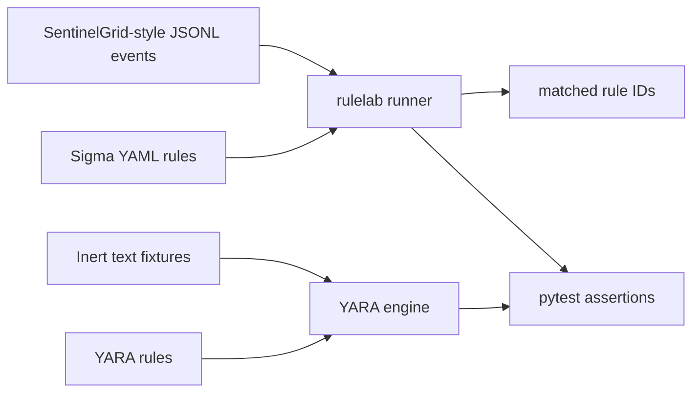

# Detection Rules Lab

A small rule-testing lab for cloud audit events: Sigma rules cover selected AWS-style activity, and YARA rules scan inert text fixtures for two suspicious string patterns. The event schema is intentionally normalized for this project and can be mapped from SentinelGrid-ATK scenarios.

## Problem / why it matters

Detection rules need repeatable tests. A rule that looks plausible can miss the event it was meant to catch, or match ordinary activity too broadly. This repository keeps each example close to a positive event, a negative control, and a small local test harness.

## What is included

- Three Sigma-style rules for access-key creation, CloudTrail logging changes, and failed console logins.
- Two YARA rules tested only against harmless text fixtures. They do not inspect or execute binaries.
- A Python runner for the documented subset of Sigma selector matching used here: equality checks over normalized, flat JSON event fields.
- Synthetic JSONL events, positive and negative YARA fixtures, and pytest coverage.

The runner is a teaching harness, not a full Sigma compiler or a replacement for a SIEM's production backend. Rule metadata follows Sigma conventions; `product: sentinelgrid` identifies the normalized event adapter used in this repository.

## Architecture



## Results / evaluation

All events and fixtures are locally authored synthetic examples. The tests assert that each included rule matches its positive fixture and does not match its negative control. These are functional checks of the small harness, not evidence of real-world detection quality or coverage.

## Run it

Requires Python 3.9 or later. Install dependencies and run the tests and event matcher:

```bash
python -m venv .venv
source .venv/bin/activate
python -m pip install -r requirements.txt
python -m pytest -q
python -m rulelab.cli samples/events.jsonl
```

The runner prints one JSON object per matching event. `make test` and `make rules` provide the same common commands. GitHub Actions runs the tests on pushes and pull requests.

## Data and rule provenance

No external dataset or event feed is bundled. JSONL records and text fixtures are synthetic and were written for this repository. Sigma rule structure is based on the public Sigma rule specification; the YARA files use the public YARA rule language. Check the upstream projects' current licenses before copying or redistributing their rule content. The example rules here are original, minimal patterns and do not claim upstream endorsement.

## Design decisions and lessons

- The event matcher supports a small, explicit selector subset so its behavior is easy to inspect. It rejects unsupported conditions instead of pretending to implement the whole Sigma specification.
- Positive and negative examples are paired to make accidental broad matches visible in tests.
- YARA inputs are plain text fixtures. The harness never launches sample content or scans a host filesystem.
- Field names in the Sigma examples map to the normalized SentinelGrid event vocabulary, so a real adapter would need to normalize source logs before evaluation.

## Limitations and next steps

These rules are examples, not a production detection pack. The Sigma runner does not support pipelines, modifiers, aggregations, or backend-specific field mappings. The YARA patterns are intentionally narrow and may produce false positives or miss variants. Next steps are to add tests against an official Sigma backend, document a source-log mapping, and measure rule behavior against a larger labeled corpus before making operational claims.

## License

MIT. See [LICENSE](LICENSE).
